# Nexora Crypto

**Nexora Crypto** est une application web de simulation de trading de cryptomonnaies. Elle permet aux utilisateurs de gérer un portefeuille virtuel, acheter et vendre des cryptomonnaies en temps réel à partir de l'API CoinGecko.

---

## 🔍 Aperçu de l'application

<p align="center">
  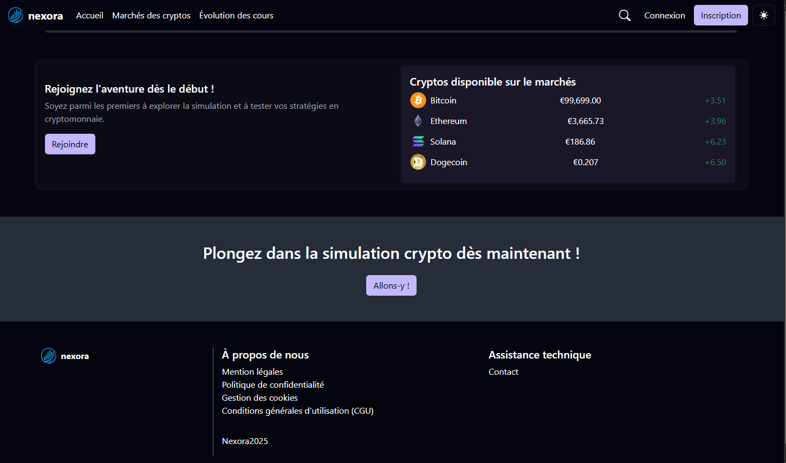
  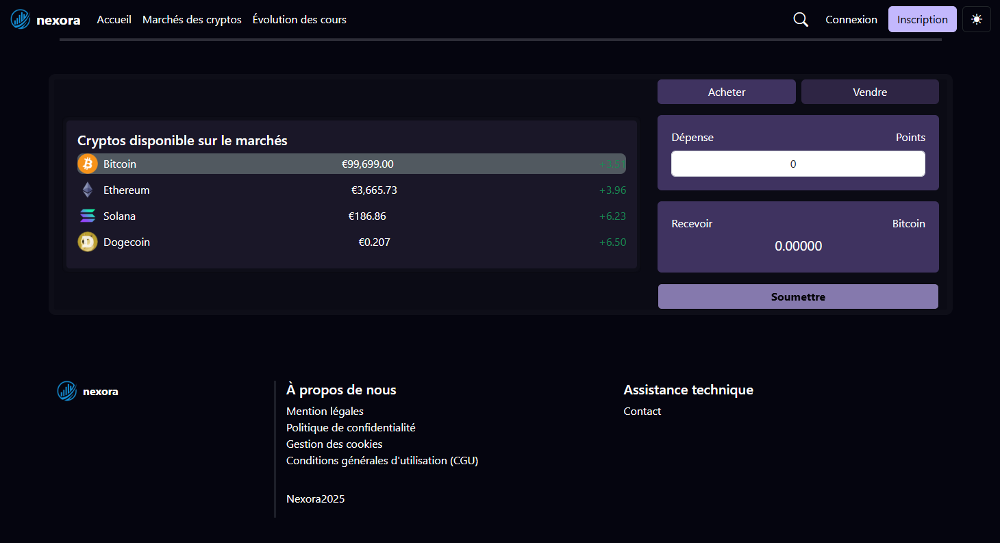
  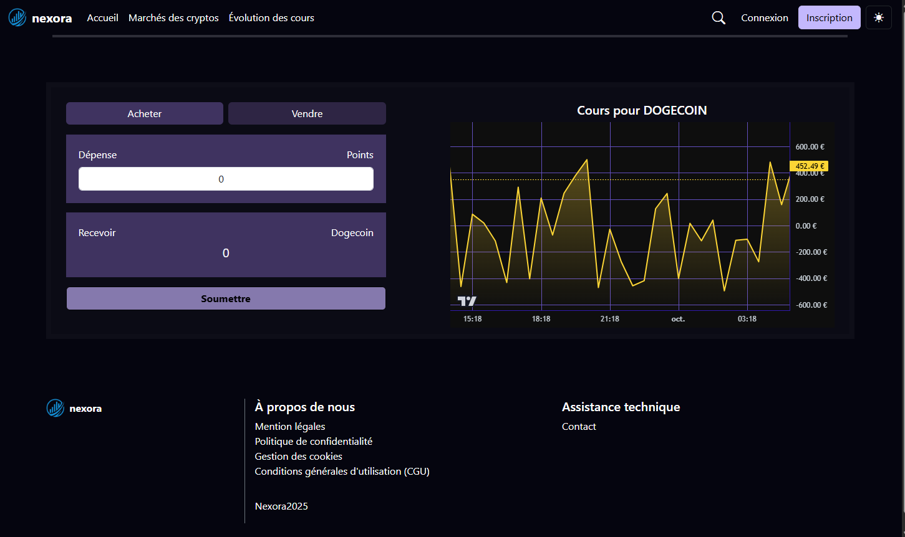
  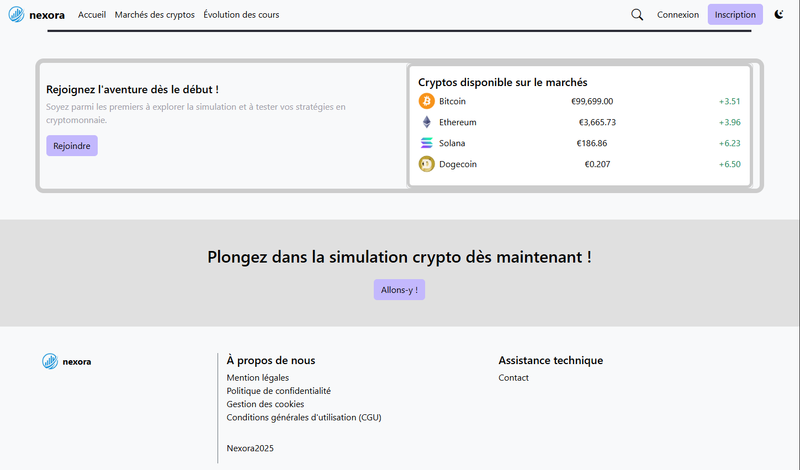
  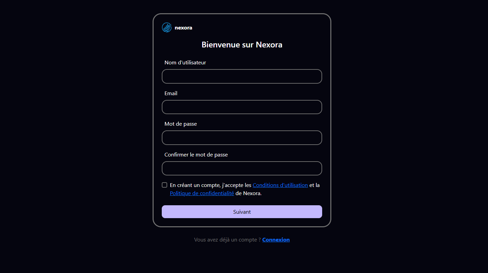
  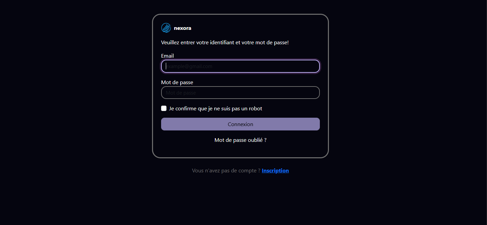
</p>

---

## Fonctionnalités principales

- Inscription avec vérification par e-mail
- Connexion sécurisée via JWT (cookies HttpOnly)
- Achat / vente de cryptomonnaies avec suivi de solde
- Portefeuille avec variation de prix en temps réel
- Historique des transactions
- Mode sombre & clair

---

## Stack technique

- **Backend** : Java 17, Spring Boot, Spring Security, JWT
- **Frontend** : Angular
- **Bases de données** : MySQL (données métier), MongoDB (cache des prix CoinGecko)
- **Infra** : Docker, Docker Compose, Nginx, Jenkins

---

## Structure du projet

- `nexora-crypto-api/` : API REST Spring Boot
- `nexora-crypto-dashboard/webapps/dashboard/` : application Angular
- `docker-compose.yml` : déploiement (MySQL, MongoDB, backend, frontend)
- `docker-compose.dev.yml` : services de développement local (MySQL, MongoDB, Mailpit)

---

## Développement en local

Aucune donnée ni aucun secret de production n'est nécessaire : les e-mails sont interceptés par [Mailpit](https://mailpit.axllent.org/).

### Prérequis

- Docker & Docker Compose
- Java 17
- Node.js et npm

### Étapes

1. Cloner le projet :
```bash
git clone https://github.com/koceila-Hk/nexora_crypto_app.git
cd nexora_crypto_app
```

2. Lancer les services de développement :
```bash
docker compose -f docker-compose.dev.yml up -d
```

3. Lancer le backend (le profil `local` est actif par défaut) :
```bash
cd nexora-crypto-api
./mvnw spring-boot:run
```

4. Lancer le frontend :
```bash
cd nexora-crypto-dashboard/webapps/dashboard
npm install
npm start
```

5. Accéder à l'application :
- Frontend : http://localhost:4200
- Backend : http://localhost:8080
- E-mails (codes de vérification, réinitialisation) : http://localhost:8025

---

## Déploiement avec Docker Compose

1. Créer un fichier `.env` à la racine du projet (il est ignoré par git, ne jamais le commiter) :

```env
# MySQL
MYSQL_ROOT_PASSWORD=xxxxx
MYSQL_DATABASE=xxxxxx

# JWT
SECURITY_JWT_SECRET_KEY=xxxxxx
SECURITY_JWT_EXPIRATION_TIME=xxxxx
APPLICATION_SECURITY_JWT_REFRESH_TOKEN_EXPIRATION=xxxxxx

# Mail (SMTP Brevo)
SPRING_MAIL_HOST=smtp-relay.brevo.com
SPRING_MAIL_PORT=587
SPRING_MAIL_USERNAME=votre-login@smtp-brevo.com
SPRING_MAIL_PASSWORD=votre-cle-smtp
APP_MAIL_FROM=noreply@votre-domaine.fr

# URLs
COINGECKO_API_URL=https://api.coingecko.com/api/v3/
FRONTEND_URL=http://localhost:4200
```

> Les secrets n'ont pas de valeur par défaut : si l'un d'eux manque, le backend refuse de démarrer.

2. Lancer les services :
```bash
docker compose up -d
```

3. Accéder à l'application :
- Frontend : http://localhost:4200
- Backend : http://localhost:8080

---

## Configuration du backend

La configuration Spring est découpée par profil, dans `nexora-crypto-api/src/main/resources/` :

| Fichier | Rôle |
|---|---|
| `application.properties` | Configuration commune, toujours chargée |
| `application-local.properties` | Profil `local` (par défaut) : services de `docker-compose.dev.yml`, aucun secret |
| `application-docker.properties` | Profil `docker` (production) : valeurs lues depuis les variables d'environnement du `.env` |
| `application-test.properties` | Profil `test` : base H2 en mémoire, utilisé par `mvn test` |

Un profil ne contient que les valeurs qui diffèrent de `application.properties`.

---

## Conception du système

### Diagramme de classes

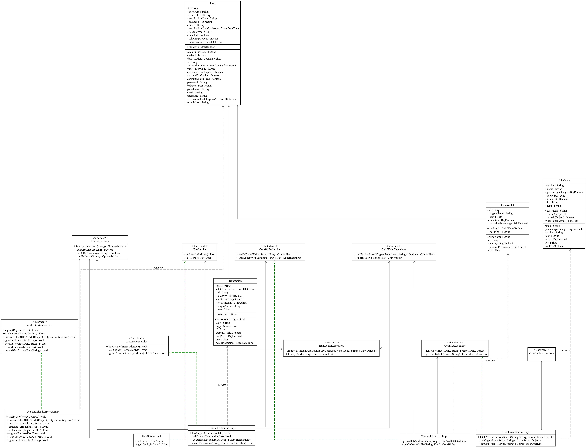

### Diagramme de séquence

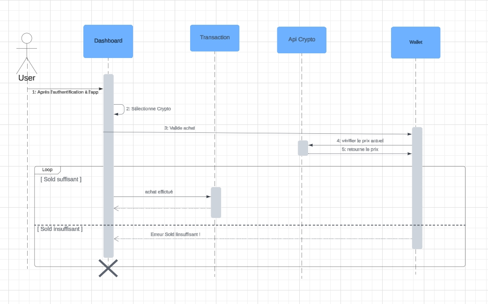

### Diagramme de cas d'utilisation

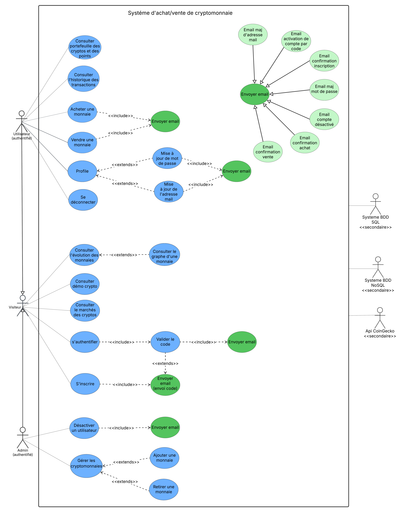

### Diagramme d'activité

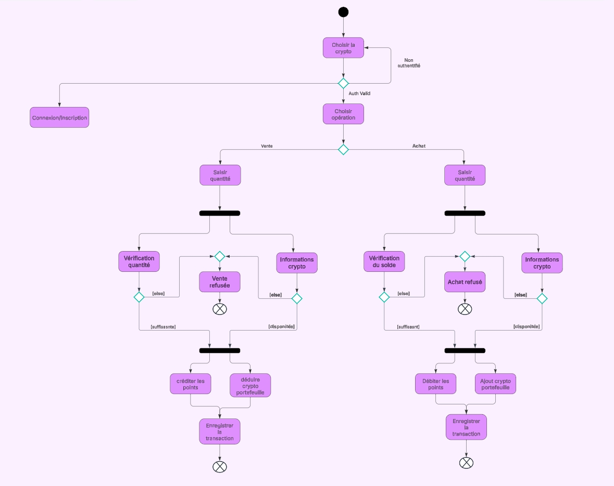

### Diagramme d'entité

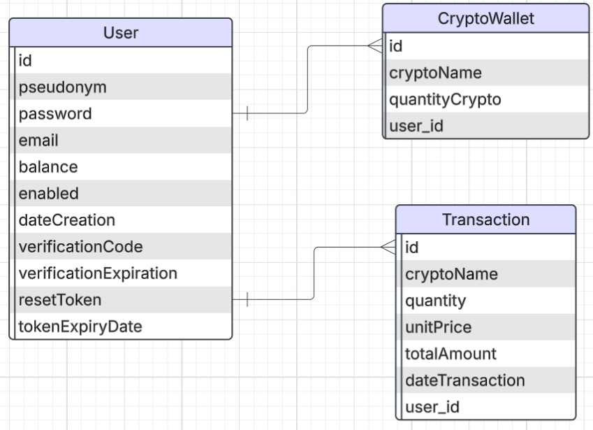

---

## Conception de la base de données

### MCD

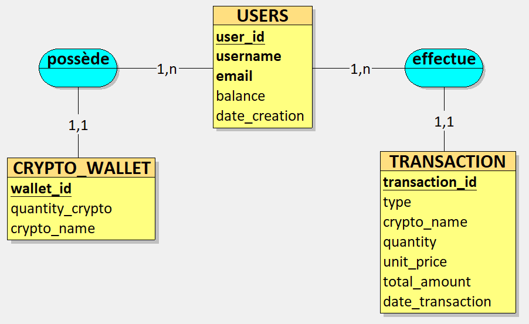

### Dictionnaire de données

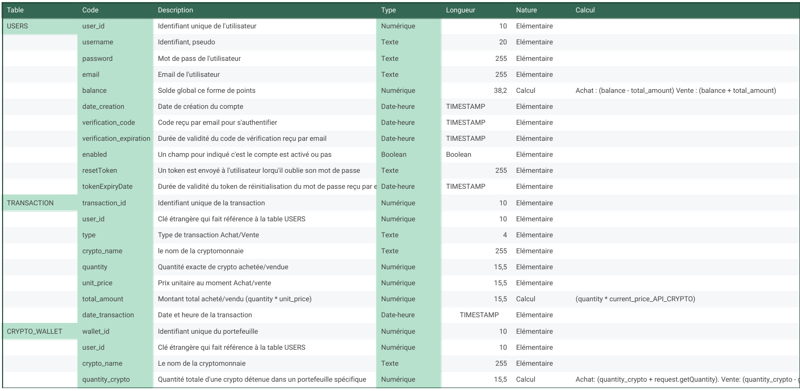

---

## Auteur

Koceila Habarek – Projet CDA – Concepteur Développeur d'Applications

---

## Contact

Pour toute remarque, suggestion ou amélioration, merci d'ouvrir une **issue** ou une **pull request**.

---

**© 2025 Nexora Crypto – Tous droits réservés**
